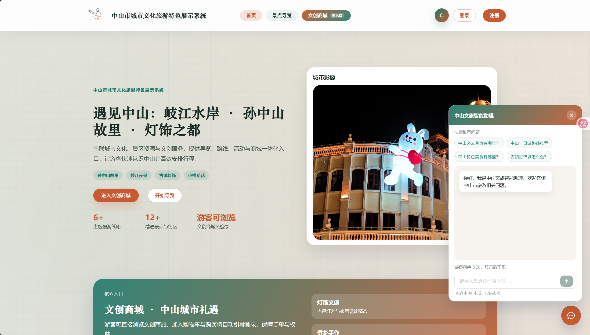
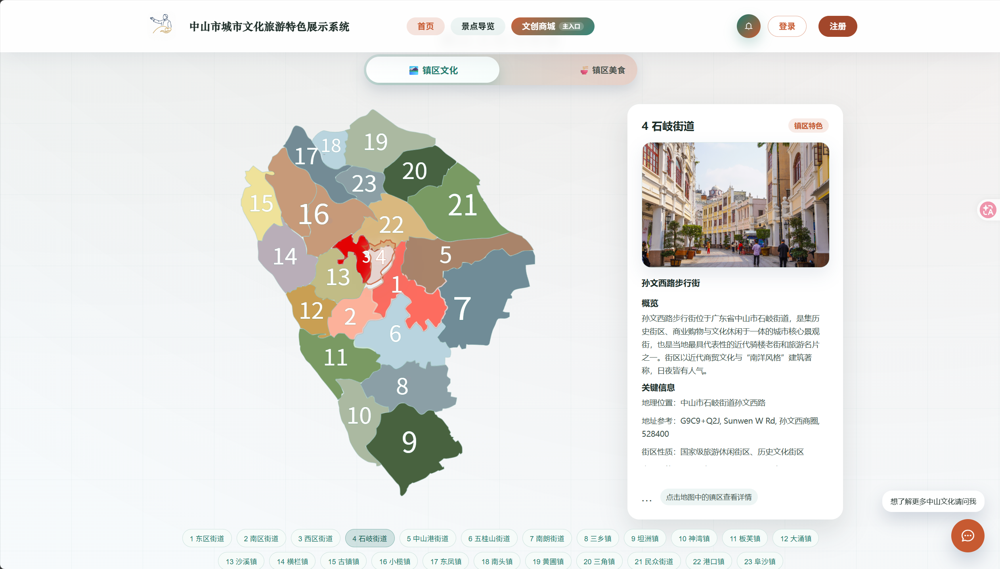
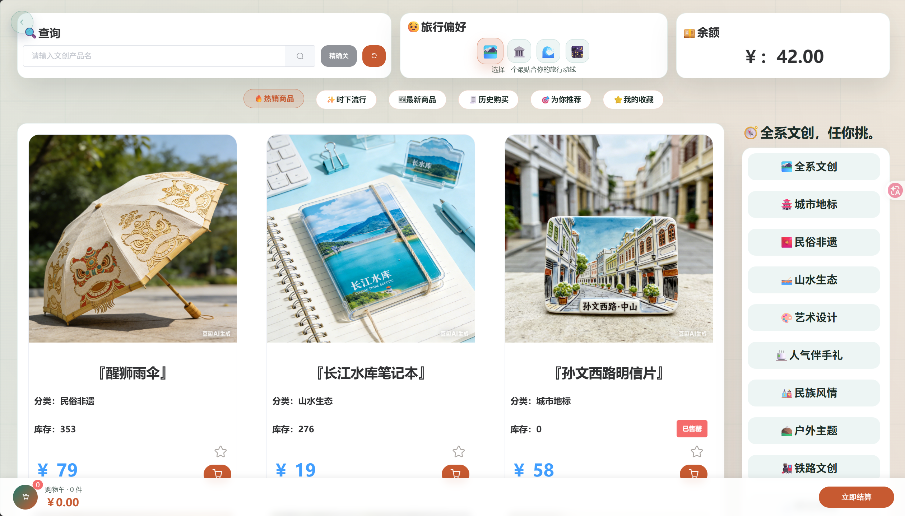
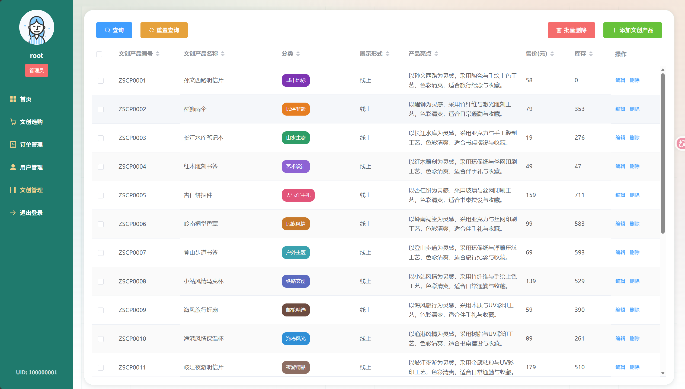
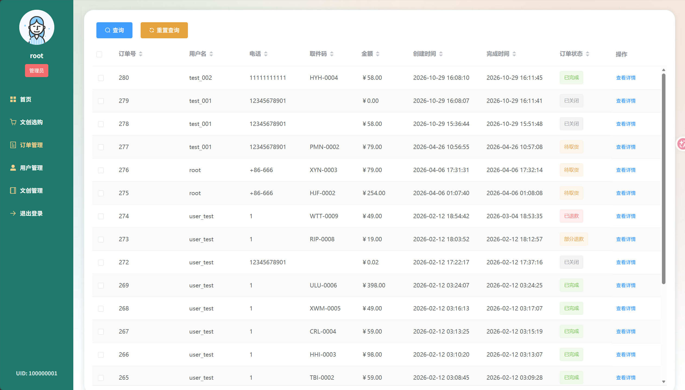
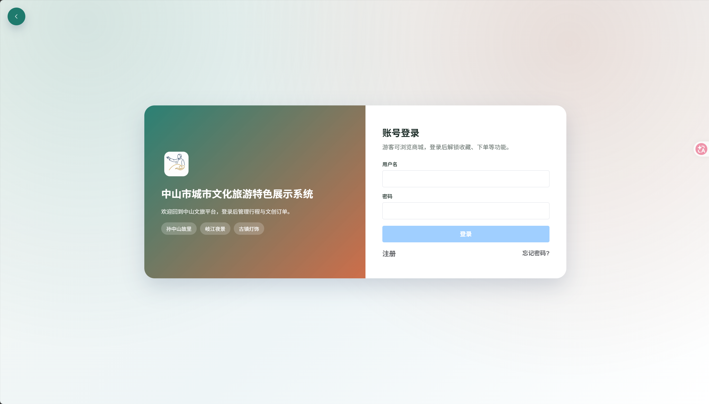
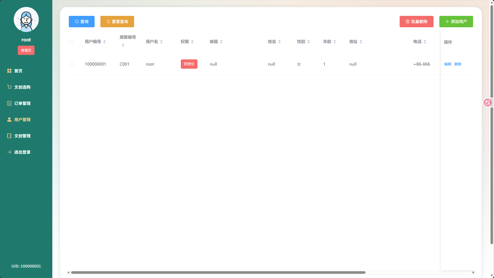
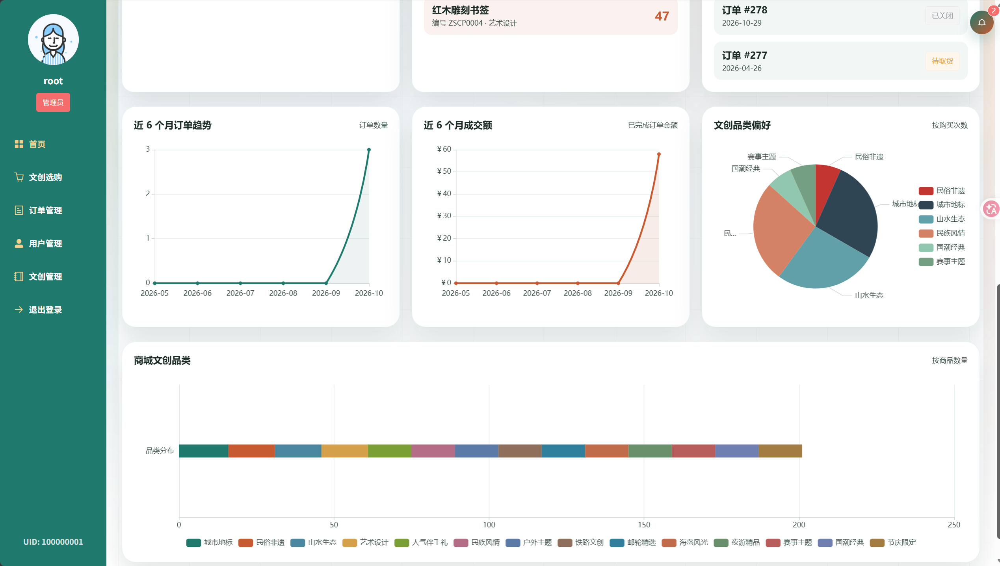
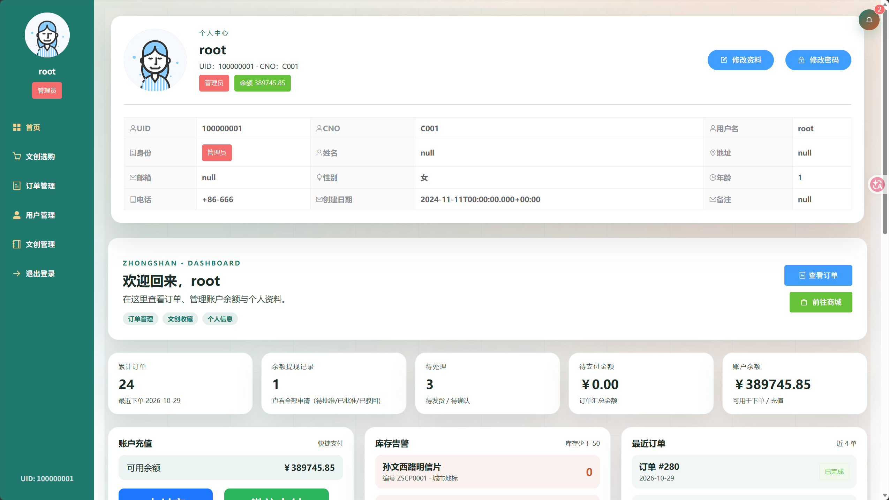

# 🏛️ Zhongshan Culture & Tourism Hub

> 中山市城市文化旅游特色展示系统——一个集城市文旅宣传、文创商城、AI 智能导览于一体的全栈 Web 应用。



---

## 🚀 快速启动

### 1. 克隆项目

```bash
git clone https://github.com/XiaoHouLin/graduation_project.git
cd graduation_project
```

### 2. 初始化数据库

```bash
# 登录 MySQL，创建数据库并导入表结构
mysql -u root -p
```

```sql
CREATE DATABASE tourism DEFAULT CHARACTER SET utf8mb4;
USE tourism;
SOURCE tourism.sql;
```

### 3. 配置敏感信息

复制配置模板并填写真实值：

```bash
cp config/application-secrets.example.yml config/application-secrets.yml
```

编辑 `config/application-secrets.yml`，填入通义千问 API Key。

其余配置（数据库、邮箱等）可通过环境变量或直接修改 `application.yml`。

### 4. 启动后端

```bash
cd tourism_back_end
./mvnw spring-boot:run
```

后端默认运行在 `http://localhost:8080`。

### 5. 启动前端

```bash
cd tourism_front_end
npm install
npm run serve
```

前端默认运行在 `http://localhost:7070`。浏览器打开该地址即可体验系统。

---

## 📑 目录

- [快速启动](#-快速启动)
- [项目简介](#-项目简介)
- [技术栈](#-技术栈)
- [系统架构](#-系统架构)
- [核心功能](#-核心功能)
- [项目亮点](#-项目亮点)
- [项目结构](#-项目结构)
- [数据库设计](#-数据库设计)
- [API 接口概览](#-api-接口概览)
- [环境要求](#-环境要求)
- [配置说明](#-配置说明)
- [项目截图](#-项目截图)

---

## 📖 项目简介

本项目是一个面向中山市文化旅游场景的全栈 Web 系统，致力于将城市历史文化、旅游景区、文创产品三者融合，为游客提供一站式的城市文旅体验。系统涵盖 **前台门户展示** 与 **后台管理系统** 两大部分，支持游客浏览、用户注册登录、文创商品购买、订单管理、AI 智能问答、实时消息推送等核心功能。

### 适用场景

| 角色 | 使用场景 |
|------|---------|
| **游客（未登录）** | 浏览首页宣传、景点导览、文创商城商品列表、AI 旅游咨询（限次） |
| **注册用户** | 购买文创商品、管理订单、余额充值/提现、个人信息管理、消息中心 |
| **管理员** | 用户管理、商品管理、订单审核、退款审批、提现审批、数据统计 |

---

## 🛠️ 技术栈

### 后端

| 技术 | 版本 | 说明 |
|------|------|------|
| **Java** | 17 | 编程语言 |
| **Spring Boot** | 3.3.4 | 核心框架 |
| **MyBatis** | 3.0.3 | ORM 持久层框架 |
| **MySQL** | 8.0 | 关系型数据库 |
| **JWT (jjwt)** | 0.9.1 | 用户认证 & 令牌管理 |
| **Spring Security Crypto** | - | 密码加密（BCrypt） |
| **Spring Mail** | - | 邮件验证码服务 |
| **PageHelper** | 1.4.6 | MyBatis 分页插件 |
| **Fastjson** | 1.2.83 | JSON 序列化 |
| **Lombok** | - | 简化 Java Bean 代码 |
| **Logback** | 1.5.13 | 日志框架 |
| **通义千问 API** | qwen3-max | AI 智能问答（阿里云 DashScope） |

### 前端

| 技术 | 版本 | 说明 |
|------|------|------|
| **Vue.js** | 2.6 | 渐进式 JavaScript 框架 |
| **Vue Router** | 3.5 | 前端路由（History 模式） |
| **Vuex** | 3.6 | 状态管理 |
| **Element UI** | 2.15 | UI 组件库 |
| **Axios** | 1.7 | HTTP 请求库（含自动重试） |
| **ECharts / V-Charts** | 4.9 / 2.0 | 数据可视化 |
| **QRCode** | 1.5 | 取货二维码生成 |
| **jwt-decode** | 4.0 | JWT 令牌解析 |
| **Lodash** | 4.17 | 工具函数库 |
| **vue-infinite-loading** | 2.4 | 无限滚动加载 |

---

## 🏗️ 系统架构

```
┌─────────────────────────────────────────────────────────────┐
│                        浏览器 / 客户端                        │
│  Vue 2 + Element UI + Vuex + Vue Router + ECharts           │
└───────────────┬────────────────────────┬────────────────────┘
                │ HTTP/REST              │ SSE (Server-Sent Events)
                ▼                        ▼
┌─────────────────────────────────────────────────────────────┐
│                     Spring Boot 3.3.4                        │
│  ┌──────────────┐ ┌───────────────┐ ┌────────────────────┐  │
│  │ JWT 拦截器    │ │ REST 控制器    │ │  SSE 实时推送服务   │  │
│  └──────────────┘ └───────────────┘ └────────────────────┘  │
│  ┌──────────────┐ ┌───────────────┐ ┌────────────────────┐  │
│  │ 业务服务层    │ │ 邮件验证服务   │ │ 通义千问 AI 服务    │  │
│  └──────────────┘ └───────────────┘ └────────────────────┘  │
│  ┌──────────────┐ ┌───────────────┐ ┌────────────────────┐  │
│  │ MyBatis ORM  │ │ 定时任务调度   │ │ AES-GCM 加密工具   │  │
│  └──────────────┘ └───────────────┘ └────────────────────┘  │
└───────────────┬────────────────────────┬────────────────────┘
                │ JDBC                   │ SMTP
                ▼                        ▼
        ┌──────────────┐         ┌──────────────┐
        │  MySQL 8.0   │         │  邮件服务器   │
        │  (tourism)   │         │  (SMTPS)     │
        └──────────────┘         └──────────────┘
```

---

## ✨ 核心功能

### 1. 🏠 城市文旅门户首页

- 响应式首页设计，展示中山市城市文化名片
- **景点导览模块**：孙中山故里、石岐老城、岐江夜景、古镇灯饰、五桂山等 5 大主题区域
- **推荐路线**：城市记忆线、岐江夜游线、灯饰文创线等多条精品旅游线路
- **高德地图集成**：景点地理位置标注与导航




### 2. 🛍️ 文创商城系统

- **商品展示**：分页浏览、多条件筛选（编号/名称/风格/分类/价格区间/库存范围）
- **分类体系**：灯饰文创、侨乡手作、城市礼盒等多分类管理
- **购物车功能**：加入购物车、修改数量、实时价格计算
- **游客免登录浏览**：未登录用户可自由浏览商品，加购或下单时自动引导登录
- **库存控制**：下单即扣减库存，关闭/退款订单自动恢复库存
- **当月购买限制**：支持商品月度购买数量统计



管理员可在后台维护文创产品，包括新增、编辑、批量删除及库存管理。



### 3. 📦 订单全生命周期管理

- **订单状态流转**：待支付 → 待取货 → 已完成 / 已关闭

  ```
  创建订单(待支付) ──支付──→ 待取货 ──扫码取货──→ 已完成
       │                      │
       │(超时15分钟)           │(申请退款)
       ▼                      ▼
     已关闭 ←──管理员审批── 退款审核中
  ```

- **余额支付**：用户使用账户余额直接支付订单
- **取货码 & 二维码**：支付成功后生成加密取货码，基于 **AES-GCM** 加密算法
- **管理员扫码取货**：管理员扫描用户二维码确认取货
- **退款机制**：用户申请退款 → 管理员审批 → 自动退还余额并恢复库存
- **订单超时关闭**：定时任务每 60 秒扫描，超过 15 分钟未支付的订单自动关闭
- **前端倒计时**：待支付订单展示剩余支付时间



### 4. 🤖 AI 智能旅游助手

- 集成 **阿里云通义千问（Qwen3-Max）** 大模型
- 支持多轮对话，具备上下文记忆能力
- **话题域限制**：通过关键词匹配 + System Prompt 双重机制，确保仅回答中山市旅游相关问题
- **思维链展示**：支持展示 AI 的推理过程（reasoning_content）
- **临时令牌机制**：使用阿里云 DashScope 临时 Token，增强 API Key 安全性
- **快捷问题推荐**：预设 4 个常见旅游问题供用户快速提问
- **游客限次对话**：未登录用户每次访问限 3 次对话，登录后无限制


### 5. 🔐 用户认证与安全体系

- **JWT 令牌认证**：无状态登录，Token 存储于 SessionStorage
- **Spring Security Crypto 密码加密**：BCrypt 算法加密用户密码
- **邮箱验证码**：注册、修改邮箱、重置密码均需邮箱验证码校验（5 分钟有效期）
- **登录失败防护**：连续 3 次登录失败后触发滑块验证码（算术题验证）
- **路由级权限控制**：前端路由守卫 + 后端拦截器双重校验
- **RBAC 角色体系**：管理员（authority=1）和普通用户（authority=3），按角色控制可访问页面
- **Token 过期自动跳转**：前端自动检测 Token 过期并跳转登录页



管理员可基于角色权限查看、编辑和批量管理用户信息。



### 6. 📡 SSE 实时消息推送

- 基于 **Server-Sent Events (SSE)** 技术，实现服务端到客户端的实时事件推送
- **多事件类型**：
  - `ORDER_UPDATED`：订单状态变更通知用户
  - `ADMIN_PENDING_ORDER`：新订单提醒管理员
  - `ADMIN_REFUND_REQUEST`：退款申请通知管理员
  - `ADMIN_WITHDRAW_REQUEST`：提现申请通知管理员
  - `GLOBAL_REFRESH`：全局数据刷新
- **断线自动重连**：指数退避策略（2s → 20s 上限），保障连接稳定
- **用户在线检测**：实时判断用户是否在线，防止误删在线用户

### 7. 💰 账户余额与资金管理

- **余额充值**：管理员可为用户调整余额
- **余额提现**：用户可申请提现，每日限 1 次
- **资金流水**：完整记录每笔资金变动（充值/消费/退款/提现/管理员调整），含变动前后余额
- **提现审批**：管理员审核通过 / 驳回用户提现申请

### 8. 🔔 消息中心

- **站内消息**：订单状态变更、退款结果、提现审批结果等系统通知
- **未读标记**：消息中心 Badge 展示未读消息数
- **消息管理**：标记已读、删除消息

### 9. 📊 数据统计与可视化

- **品类统计**：文创产品品类分布（饼图/柱状图）
- **个人偏好统计**：用户个人购买品类偏好分析
- **商城品类统计**：整体商城商品品类数据



### 10. 👤 个人中心

- **个人信息管理**：修改用户名、邮箱（需双重验证码）
- **密码修改**：旧密码验证 + 新密码强度校验（8-20位，需包含字母和数字）
- **忘记密码**：通过邮箱查找账号 → 发送验证码 → 重置密码
- **账号注销**：用户可主动注销账号（余额为 0 时）



---

## 🌟 项目亮点

### 架构设计

- ✅ **前后端完全分离**：Vue.js + Spring Boot，RESTful API 通信，便于独立部署和维护
- ✅ **三层分层架构**：Controller → Service → Mapper/DAO，职责分明，易于扩展
- ✅ **配置外部化**：敏感信息（API Key、数据库密码、邮箱配置）通过环境变量或外部配置文件注入，不提交至版本库

### 安全能力

- 🔒 **多层安全防护**：JWT 拦截器 + 路由守卫 + RBAC + BCrypt + 验证码，构建完整安全体系
- 🔒 **AES-GCM 取货码加密**：取货二维码内容使用 AES-GCM 对称加密，防止伪造
- 🔒 **临时令牌机制**：AI 服务调用使用可刷新的临时 Token，避免 API Key 直接暴露
- 🔒 **登录防暴力破解**：失败次数阈值 + 算术验证码 + 滑块交互

### 实时体验

- ⚡ **SSE 实时推送**：无需轮询，服务端主动推送订单变更、管理员通知等事件
- ⚡ **断线自动重连**：指数退避重连策略，保障长连接稳定性
- ⚡ **EventBus 组件通信**：Vue EventBus 实现跨组件实时数据同步

### AI 能力集成

- 🤖 **通义千问大模型**：集成阿里云 Qwen3-Max，提供智能旅游咨询
- 🤖 **话题域限制**：正则匹配 + System Prompt 双重机制，确保 AI 仅回答旅游相关问题
- 🤖 **思维链可视化**：前端可展示 AI 的推理过程，增强可解释性

### 业务完整性

- 📦 **完整订单生命周期**：下单 → 支付 → 取货 → 完成 / 退款，全流程闭环
- 📦 **定时任务自动关单**：基于 `@Scheduled` 的超时订单自动关闭机制
- 📦 **资金流水审计**：每笔资金变动均有完整的变动前后余额记录
- 📦 **库存事务安全**：下单扣库存、退款/关单恢复库存，保障数据一致性

---

## 📁 项目结构

```
graduation_project/
├── README.md                          # 项目说明文档
├── tourism.sql                        # 数据库初始化脚本
├── config/
│   └── application-secrets.example.yml # 敏感配置示例文件
│
├── tourism_back_end/                  # 🔧 后端项目 (Spring Boot)
│   ├── pom.xml                        # Maven 依赖配置
│   ├── src/main/java/com/example/tourism_rear/
│   │   ├── TourismRearApplication.java         # 启动类
│   │   ├── config/                             # 配置类
│   │   │   ├── CorsConfig.java                 # CORS 跨域配置
│   │   │   ├── JwtConfig.java                  # JWT 配置
│   │   │   ├── WebConfig.java                  # Web 拦截器 & 跨域配置
│   │   │   └── OrderExpireScheduler.java       # 超时订单定时关闭任务
│   │   ├── interceptor/
│   │   │   └── LoginCheckInterceptor.java      # JWT 登录校验拦截器
│   │   ├── controller/                         # 控制器层 (8 个)
│   │   │   ├── LoginController.java            # 登录 & 验证码
│   │   │   ├── RegisterController.java         # 注册 & 邮箱验证
│   │   │   ├── PasswordResetController.java    # 忘记密码 & 重置
│   │   │   ├── UserController.java             # 用户管理 & 余额 & 提现
│   │   │   ├── CulturalProductController.java  # 文创商品 CRUD
│   │   │   ├── OrderController.java            # 订单全生命周期管理
│   │   │   ├── ChatController.java             # AI 智能问答
│   │   │   ├── MessageController.java          # 消息中心
│   │   │   └── RealtimeController.java         # SSE 实时事件流
│   │   ├── service/                            # 服务层 (10 个)
│   │   │   ├── UserService.java                # 用户业务逻辑
│   │   │   ├── OrderService.java               # 订单业务逻辑
│   │   │   ├── CulturalProductService.java     # 商品业务逻辑
│   │   │   ├── QwenChatService.java            # 通义千问 AI 服务
│   │   │   ├── RealtimeService.java            # SSE 实时推送服务
│   │   │   ├── EmailVerificationService.java   # 邮箱验证码服务
│   │   │   ├── LoginAttemptService.java        # 登录防暴力破解
│   │   │   ├── MessageService.java             # 站内消息服务
│   │   │   ├── BalanceChangeService.java       # 资金流水服务
│   │   │   └── WithdrawRequestService.java     # 提现申请服务
│   │   ├── mapper/                             # MyBatis Mapper (6 个)
│   │   │   ├── UserMapper.java / .xml
│   │   │   ├── OrderMapper.java / .xml
│   │   │   ├── CulturalProductMapper.java / .xml
│   │   │   ├── MessageMapper.java / .xml
│   │   │   ├── BalanceChangeMapper.java
│   │   │   └── WithdrawRequestMapper.java
│   │   └── pack/
│   │       ├── pagination/
│   │       │   └── PageBean.java               # 分页封装
│   │       └── utils/                          # 工具 & DTO (30+)
│   │           ├── Jwt.java                    # JWT 工具类
│   │           ├── Result.java                 # 统一响应格式
│   │           ├── PickupTokenUtil.java         # AES-GCM 取货码加密
│   │           └── ...                         # 各种请求/响应 DTO
│   └── src/main/resources/
│       └── application.yml                     # 主配置文件
│
└── tourism_front_end/                 # 🎨 前端项目 (Vue.js)
    ├── package.json                   # NPM 依赖配置
    ├── vue.config.js                  # Vue CLI 配置 (端口 7070)
    ├── src/
    │   ├── main.js                    # 入口文件 (SSE 连接、拦截器、EventBus)
    │   ├── App.vue                    # 根组件
    │   ├── axios.js                   # Axios 实例 (含超时重试)
    │   ├── router/
    │   │   └── index.js               # 路由配置 & 导航守卫
    │   ├── store/
    │   │   └── index.js               # Vuex 状态管理 (Token & User)
    │   ├── utils/
    │   │   └── messageStore.js        # 本地消息持久化工具
    │   ├── components/                # 公共组件 (4 个)
    │   │   ├── ChatAssistant.vue      # AI 旅游助手组件
    │   │   ├── MessageCenter.vue      # 消息中心组件
    │   │   ├── SliderCaptcha.vue      # 滑块验证码组件
    │   │   └── HelloWorld.vue         # 默认组件
    │   └── views/                     # 页面视图 (15 个)
    │       ├── IndexView.vue          # 首页 (含高德地图)
    │       ├── LoginView.vue          # 登录页
    │       ├── RegisterView.vue       # 注册页
    │       ├── ForgotPasswordView.vue # 忘记密码
    │       ├── TravelPromotion.vue    # 景点导览 & 旅游路线
    │       ├── PickupVerify.vue       # 管理员扫码取货验证
    │       └── UserPanel/             # 用户面板 (子路由)
    │           ├── Main.vue           # 面板布局
    │           ├── UserInfo.vue        # 个人信息
    │           ├── UserHome.vue        # 用户首页
    │           ├── UserManagement.vue  # 用户管理 (管理员)
    │           ├── CulturalProductShop.vue     # 文创商城
    │           ├── CulturalProductManagement.vue # 商品管理 (管理员)
    │           ├── OrderManagement.vue  # 订单管理 (管理员)
    │           ├── billPayment.vue     # 订单支付
    │           └── CompleteBill.vue    # 支付完成
    └── public/                        # 静态资源
```

---

## 🗄️ 数据库设计

数据库名：`tourism`，使用 MySQL 8.0，共 **7 张核心数据表**。

### ER 关系图

```
┌──────────┐     1:N      ┌──────────────┐     1:N     ┌───────────────┐
│   user   │ ──────────── │    order     │ ──────────── │ orderdetails  │
│ (用户表)  │              │  (订单表)     │              │ (订单明细表)   │
└────┬─────┘              └──────────────┘              └───────┬───────┘
     │                                                          │
     │ 1:1                                                 N:1  │
     ▼                                                          ▼
┌──────────┐                                        ┌──────────────────┐
│  client  │                                        │ cultural_product │
│ (客户表)  │                                        │  (文创产品表)     │
└──────────┘                                        └──────────────────┘
     │
     │ 1:N
     ├──────────────────────┬───────────────────────┬─────────────────────┐
     ▼                      ▼                       ▼                     ▼
┌──────────────┐   ┌───────────────┐   ┌──────────────────┐   ┌──────────────────┐
│balance_change│   │message_center │   │withdraw_request  │   │                  │
│ (余额流水表)  │   │ (消息中心表)   │   │ (提现申请表)      │   │                  │
└──────────────┘   └───────────────┘   └──────────────────┘   └──────────────────┘
```

### 表结构概览

| 表名 | 说明 | 核心字段 |
|------|------|---------|
| `user` | 用户表 | uid, username, password(BCrypt), email, authority |
| `client` | 客户信息表 | cno, cname, csex, cage, caddress, cphone, balance |
| `cultural_product` | 文创产品表 | productCode, productName, category, price, stock, is_deleted(逻辑删除) |
| `order` | 订单表 | orderId, uid, totalPrice, orderStatus(0-3), pickupCode, pickupToken, refundReason |
| `orderdetails` | 订单明细表 | detailsId, orderId, productCode, purchaseNum, price |
| `balance_change` | 余额变动流水 | uid, change_type, change_amount, before_balance, after_balance |
| `message_center` | 站内消息 | uid, title, content, message_type, is_read |
| `withdraw_request` | 提现申请 | uid, amount, phone, status(0待审核/1通过/2驳回), reject_reason |

---

## 🔌 API 接口概览

### 认证相关

| 方法 | 路径 | 说明 |
|------|------|------|
| POST | `/login` | 用户登录（含验证码判断） |
| POST | `/login/captcha` | 获取算术验证码 |
| POST | `/register` | 用户注册 |
| POST | `/register/email-code` | 发送注册验证码 |
| POST | `/isUnique/{username}` | 用户名唯一性校验 |
| POST | `/api/validate-token` | Token 有效性验证 |

### 密码重置

| 方法 | 路径 | 说明 |
|------|------|------|
| POST | `/password-reset/lookup` | 查找账号（用户名/邮箱） |
| POST | `/password-reset/send-code` | 发送重置验证码 |
| POST | `/password-reset/verify-code` | 校验验证码 |
| POST | `/password-reset/confirm` | 确认重置密码 |

### 用户管理

| 方法 | 路径 | 说明 |
|------|------|------|
| GET | `/userInfo` | 分页查询用户列表 |
| GET | `/userInfo/personal/{uid}` | 获取个人信息 |
| POST | `/userInfo/update` | 更新用户信息 |
| POST | `/userInfo/updatePassword` | 修改密码 |
| POST | `/userInfo/self-delete` | 用户注销 |
| DELETE | `/userInfo/{uid}` | 删除用户（管理员） |

### 余额 & 提现

| 方法 | 路径 | 说明 |
|------|------|------|
| GET | `/userInfo/balance/history` | 余额变动记录 |
| POST | `/userInfo/balance/withdraw/request` | 发起提现申请 |
| GET | `/userInfo/balance/withdraw/today` | 当日提现状态 |
| GET | `/userInfo/balance/withdraw/records` | 提现列表（管理员） |
| POST | `/userInfo/balance/withdraw/request/{id}/review` | 审批提现（管理员） |

### 文创产品

| 方法 | 路径 | 说明 |
|------|------|------|
| GET | `/cultural-products` | 分页查询产品（支持游客免登录） |
| POST | `/cultural-products` | 新增产品 |
| POST | `/cultural-products/update` | 更新产品 |
| DELETE | `/cultural-products/{codes}` | 批量删除产品 |
| GET | `/cultural-products/categories` | 分类列表 |
| GET | `/cultural-products/category-statistics` | 品类统计 |

### 订单管理

| 方法 | 路径 | 说明 |
|------|------|------|
| POST | `/order/add` | 创建订单 |
| POST | `/order/payment` | 余额支付 |
| POST | `/order/update` | 更新购物车 |
| POST | `/order/close` | 关闭订单 |
| GET | `/order/pickup/info` | 取货信息查询 |
| POST | `/order/pickup/confirm` | 确认取货 |
| POST | `/order/refund/request` | 申请退款 |
| POST | `/order/refund/approve` | 批准退款（管理员） |
| POST | `/order/refund/reject` | 驳回退款（管理员） |
| GET | `/order/admin/list` | 全部订单（管理员） |

### 实时事件 & 消息

| 方法 | 路径 | 说明 |
|------|------|------|
| GET | `/events/stream` | SSE 事件流连接 |
| GET | `/messages` | 获取消息列表 |
| POST | `/messages/read` | 标记消息已读 |
| POST | `/messages/delete` | 删除消息 |

### AI 问答

| 方法 | 路径 | 说明 |
|------|------|------|
| POST | `/chat` | 发送问题（支持多轮对话） |

---

## 📋 环境要求

| 环境 | 版本要求 |
|------|---------|
| JDK | ≥ 17 |
| Maven | ≥ 3.6 |
| Node.js | ≥ 14 |
| npm | ≥ 6 |
| MySQL | ≥ 8.0 |

---

## ⚙️ 配置说明

### 环境变量配置（推荐）

| 变量名 | 说明 | 默认值 |
|--------|------|--------|
| `DB_URL` | 数据库连接 URL | `jdbc:mysql://localhost:3306/tourism` |
| `DB_USERNAME` | 数据库用户名 | `root` |
| `DB_PASSWORD` | 数据库密码 | (空) |
| `JWT_SECRET` | JWT 签名密钥 | 内置默认值 |
| `JWT_EXPIRE_SECONDS` | Token 有效期（秒） | `86400`（24小时） |
| `MAIL_HOST` | 邮件服务器地址 | - |
| `MAIL_PORT` | 邮件服务器端口 | - |
| `MAIL_USERNAME` | 邮箱账号 | - |
| `MAIL_PASSWORD` | 邮箱密码/授权码 | - |
| `QWEN_API_KEY` | 通义千问 API Key | - |
| `PICKUP_SECRET` | 取货码加密密钥 | 内置默认值 |

---

## 📸 项目截图

功能截图已嵌入上方对应的功能说明，源文件统一存放于 `tourism_front_end/docs/`：

| 截图 | 对应功能 |
|------|---------|
| `展示页.png`、`展示页2.png` | 城市文旅门户与景点导览 |
| `文创商城列表页.png`、`文创管理页.png` | 文创商城与后台商品管理 |
| `订单管理页.png` | 订单全生命周期管理 |
| `登录页.png`、`用户管理页.png` | 用户认证、权限与用户管理 |
| `管理员后台1.png`、`管理员后台2.png` | 管理员工作台与数据统计 |

---

## 📄 License

本项目采用 [MIT License](./LICENSE)。

---


